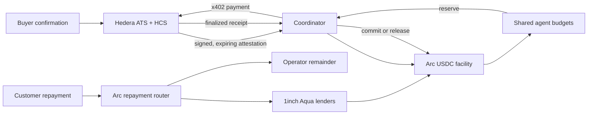

# Autonomous Working Capital System

Receivables-backed working capital for teams of AI agents. One buyer-confirmed invoice sets a shared credit ceiling, agents spend from reserved sub-budgets, and customer revenue repays lenders before the operator.

## Current prototype state

This repository contains a locally runnable demo and deterministic domain API. The Hedera gateway now has a testnet x402 client, a USDC-gated research resource server, and HCS audit submission. These require local credentials and have not yet been exercised with a live transaction. ATS issuance and Arc remain integration boundaries. No testnet transaction, ATS issuance, Arc Studio project, x402 settlement, or Aqua position is claimed until configured and verified.

## Run locally

Requirements: Node.js 20+ and Python 3.11+. The local orchestrator persists its demo state in `working_capital.db`; set `DATABASE_URL` to select another SQLite file or a PostgreSQL database.

```sh
python3 -m venv .venv
source .venv/bin/activate
pip install -r services/orchestrator/requirements.txt
uvicorn app.main:app --app-dir services/orchestrator --reload --port 8000
```

In another terminal:

```sh
npm install
npm run dev
```

Open `http://localhost:3000`. The API seeds the RetailCo invoice and demo lender/agent data automatically. Use the dashboard action buttons to replay the lifecycle; `Reset demo` returns it to the initial state. If port 8000 is already occupied, run Uvicorn on another port and start the web app with `NEXT_PUBLIC_API_BASE_URL=http://127.0.0.1:<port> npm run dev`.

## Docker setup, development, and deployment

Docker Desktop 4+ with Docker Compose v2 is the supported team setup. It runs the dashboard and API with a persistent named volume, so teammates do not need local Node or Python installations for the standard workflow.

```sh
cp .env.example .env
docker compose up --build
```

Open `http://localhost:3000`. The API is available at `http://localhost:8000/health`. Stop the stack with `docker compose down`; its demo database remains in the `orchestrator_data` volume. Use `docker compose down -v` only when deliberately resetting all container-managed demo data.

For code changes with hot reload, run the development overlay instead:

```sh
docker compose -f docker-compose.yml -f docker-compose.dev.yml up --build
```

The browser-facing API URL is compiled into the Next.js build. For a deployed environment, set `NEXT_PUBLIC_API_BASE_URL` to the externally reachable HTTPS API URL before building, and set `CORS_ORIGINS` to the dashboard's exact HTTPS origin. Keep server credentials only in the deployment environment's `.env` or secret manager - never use `NEXT_PUBLIC_` for secrets.

The default Docker stack intentionally excludes live payment services. When testnet x402 credentials are present in `.env`, start them explicitly:

```sh
docker compose --profile hedera up --build
```

The research service and x402 gateway are published only on host loopback ports `4021` and `4022`. Inside Compose they communicate over the private Docker network; the API must be configured with `HEDERA_PAYMENT_MODE=live`, `HEDERA_GATEWAY_API_TOKEN`, and `HEDERA_GATEWAY_URL=http://x402-gateway:4022` to use that live gateway. Do not enable this profile without funded testnet credentials and a real HCS audit topic.

## Hedera testnet x402 slice

The research resource is priced at $0.25 in Hedera testnet USDC. The paying agent key and HCS submit key stay server-side in `.env`; never put them in `NEXT_PUBLIC_*` variables or commit them. The example configuration restricts the payer to the configured USDC token, merchant account, research URL, and a per-payment ceiling. Testnet x402 payments are real transfers and spend the agent account's USDC.

Before running it, create or select a Hedera testnet payer account with USDC `0.0.429274` associated and at least $0.25 USDC. Create an HCS topic, fund the audit operator with testnet HBAR for fees, and ensure its key is permitted to submit to that topic. Fill the `HEDERA_AGENT_*`, `HEDERA_RESEARCH_MERCHANT_ID`, and `HEDERA_AUDIT_*` entries in `.env`. Keep `HEDERA_NETWORK=hedera:testnet`.

Start by copying `.env.example` to `.env`, then fill only the testnet values above. The payer key signs x402 transfers; the audit key signs HCS messages. They can be the same test account if it has the required token association and topic submit permission.

In one terminal, start the paid research resource:

```sh
npm run hedera:research:serve
```

In another, request the service with the x402 client. This signs and settles a real $0.25 USDC payment, then publishes the transaction reference to the configured HCS topic:

```sh
npm run hedera:research:pay
```

The command prints the HashScan transaction URL and HCS audit transaction ID. If either integration is not configured or the facilitator does not return a confirmed settlement, the command fails rather than reporting a simulated success. The dashboard still uses its local demo mode; this initial Hedera slice is currently exercised through the gateway commands, not the dashboard action.

The orchestrator can now use the same gateway. Keep `HEDERA_PAYMENT_MODE=simulated` for local rehearsals. For a live testnet payment, set it to `live`, configure `HEDERA_GATEWAY_API_TOKEN` with a local secret, then start both services:

```sh
npm run hedera:research:serve
npm run hedera:x402:gateway
npm run api:dev
```

The gateway is localhost-only and requires its bearer token. It permits only the configured research endpoint, merchant, testnet USDC asset, and payment ceiling. A finalized Hedera receipt is required before the orchestrator records a non-simulated spend. The gateway's idempotency cache is process-local, so durable payment reconciliation remains required before production use.

## ATS receivable issuance and Google ADK

The gateway now uses the official ATS SDK to construct a testnet, single-unit bond request for a buyer-confirmed receivable. One bond represents one USDC-denominated claim. The canonical receivable ID and buyer account are retained in ATS `info` metadata; the issuer must supply an approved ISIN or equivalent asset identifier.

The included `.env` is configured with public testnet Mirror Node, JSON-RPC, resolver, and factory defaults. It deliberately leaves `HEDERA_ATS_CONFIG_ID`, `HEDERA_ATS_CONFIG_VERSION`, and `HEDERA_ATS_ISSUER_ACCOUNT_ID` empty because they identify the issuer's active ATS deployment and wallet. Set those values, then validate the exact request without signing or submitting anything:

```sh
npm run hedera:ats:prepare
```

`services/orchestrator/working_capital_agent/agent.py` provides the Google ADK coordinator. Its `prepare_ats_issuance` tool validates a proposed issuance and only produces an issuer-wallet review payload. It cannot connect a wallet, sign, issue an asset, or move funds. Configure `GOOGLE_API_KEY` only when running the ADK agent against Gemini.

```sh
npm run adk:run
```

## Aqua lender-market adapter

`services/aqua-gateway` pins the official 1inch Aqua and SwapVM SDKs. It is constrained to Arc chain ID `5042`, takes its Aqua registry and SwapVM router addresses from the SDK, filters lender strategies by buyer score, advance rate, tenor, expiry, and liquidity, then allocates cheapest APR first. It also encodes an Aqua `ship` transaction for a lender-approved strategy.

```sh
npm run aqua:test
```

Set `AQUA_RPC_URL` and `AQUA_USDC_ADDRESS` in `.env` before using it against Arc. A quote remains `QUOTED` until the lender wallet signs, submits, and the system reconciles the transaction receipt. Do not treat strategy construction, transaction calldata, or a local plan as a funded position.

## Architecture



Hedera, Arc, and the selected Aqua deployment are separate environments. The prototype coordinator is a trust assumption and the cross-chain lifecycle is not atomic.

## V1 implementation plan

See [`docs/PLAN.md`](docs/PLAN.md) for the phased build, gates, integration boundaries, and acceptance criteria. Product requirements are in [`docs/Autonomous_Working_Capital_System.docx`](docs/Autonomous_Working_Capital_System.docx).

## Demo scenario

- Invoice: $10,000, Net 30, 75% maximum advance.
- Eligible lender offers: Alice at 7% ($4,000) and Bob at 8.5% ($2,000); Charlie at 13% is not selected.
- Funded amount: $6,000; shared budget: Research $1,000, Compute $3,000, Data $1,000, Reserve $1,000.
- Research makes a $0.25 x402 payment in the live integration. In local mode, the API records a simulated receipt.
- The $5,500 compute request exceeds its $3,000 allocation and must fail as `AGENT_BUDGET_EXCEEDED`.
- Repayment computes each lender fee from principal, APR, and elapsed term; the operator receives the remainder after lender obligations.

## Integration status and required evidence

| Integration | Local prototype | Needed for live demo |
|---|---|---|
| Hedera ATS | SDK-backed, testnet-only receivable-bond request builder; no wallet submission yet | issuer ATS config/version, wallet connection, submitted transaction and Mirror Node evidence |
| Google ADK | local coordinator with a bounded issuance-preparation tool | Gemini API key and agent runtime exercise |
| HCS / HCS-14 | HCS publisher implemented; HCS-14 registration not wired | topic ID, submit permission, agent profiles, Mirror Node confirmation |
| Hedera x402 | testnet client and sample paid resource implemented; not yet live-verified | funded/associated payer, merchant account, facilitator settlement and transaction evidence |
| Arc / USDC | contract source scaffold | Arc Studio project, testnet deployment, funded test wallets |
| 1inch Aqua / SwapVM | official SDK-backed Arc adapter with deterministic offer selection and `ship` calldata builder | lender strategy bytes, funded wallet, signed `ship` or SwapVM fill, and verified Arc receipt |

## Security

- Never put operator keys or facilitator secrets in browser configuration.
- Use testnet-only funded accounts for demonstrations.
- Credit decisions are deterministic; an AI model must not approve or change limits.
- Chain actions must be idempotent and reconcile from finalized receipts before retry.

## Prize submission checklist

- Arc Studio project URL and a demo segment showing Arc Studio.
- Hedera testnet x402 transaction ID and HashScan link.
- Verified ATS token and lifecycle operation.
- Aqua/SwapVM strategy and on-chain transfer evidence.
- Public repository, architecture diagram, setup steps, and a demo video under five minutes.
